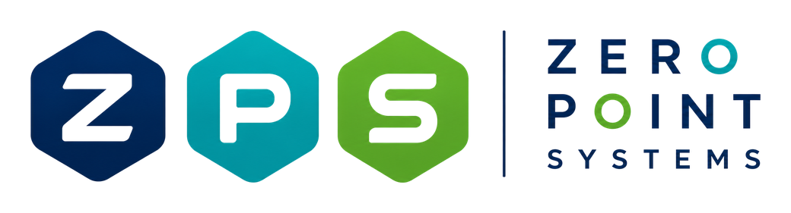

<p align="center">
  
</p>

<h1 align="center">ZPS MacClean</h1>

<p align="center">
  Công cụ dọn rác hệ thống thông minh cho macOS.<br>
  <b>From Zero To Possibilities. Build Smart. Scale Fast.</b>
</p>

<p align="center">
  <a href="https://github.com/toannghia/zps-macclean/raw/main/download/ZPS-MacClean-1.0.dmg"><b>Tải ZPS MacClean 1.0 (.dmg)</b></a>
</p>

ZPS MacClean dọn rác do công cụ lập trình và công cụ AI để lại, đồng thời cho xem ứng dụng nào đang dùng nhiều RAM và CPU. App miễn phí, chạy hoàn toàn trên máy của bạn và không gửi dữ liệu đi đâu.

## Tính năng

**Dọn rác**
- Claude Code, Claude Desktop, Antigravity, Gemini CLI, Codex: cache, log, ảnh chụp tạm, bản quay màn hình của agent
- VS Code, Cursor, Windsurf, Antigravity IDE: cache, gói extension, extension bản cũ
- Xcode, Android SDK, Gradle, Flutter
- Docker build cache
- npm, pnpm, Homebrew, pip, Yarn, CocoaPods, Maven, NuGet, Cargo
- Bản sao code-sign do Chrome và Brave để lại, file tạm hệ thống
- Thư mục tái tạo được trong dự án lâu không đụng tới: `node_modules`, `.next`, `build`, `Pods`, `target`, `.venv` và các thư mục tương tự

**Ảnh & Video** (trên thư mục bạn chọn, không đụng tới thư viện Photos)
- Tìm ảnh và video trùng: giống hệt từng byte, hoặc nhìn giống nhau như bản đã nén lại, đổi cỡ. Không chọn sẵn file nào; bạn tự chọn bản cần xoá hoặc bấm Chọn bản thừa, mỗi nhóm luôn giữ lại ít nhất một bản và file xoá vào Thùng rác.
- Nén ảnh JPEG, HEIC: chỉnh chất lượng, thu nhỏ, đổi sang HEIC. Giữ EXIF như ngày chụp, vị trí.
- Sắp xếp ảnh theo ngày chụp vào thư mục Năm / Tháng, có xem trước và hoàn tác.
- Nén video bằng HEVC hoặc H.264, giữ ngày quay.
- Mặc định bản nén nằm trong thư mục `ZPS Đã nén`, bản gốc giữ nguyên. Khi chọn ghi đè, bản gốc vào Thùng rác.

**Quản lý tiến trình**
- Xem RAM và CPU theo từng ứng dụng, cập nhật mỗi 3 giây
- Tắt hoặc buộc tắt ứng dụng và tiến trình
- Tiến trình hệ thống được ẩn sẵn và không tắt được

**Hướng dẫn trong app**
- Mỗi mục đều giải thích đây là gì, xoá thì sao, lấy lại thế nào và nên làm gì

## An toàn

- Chỉ tick sẵn cache thuần. Mục tốn thời gian tải lại do bạn tự chọn.
- Không bao giờ đụng tới lịch sử chat, memory của AI, token đăng nhập, Docker image và volume, mã nguồn, `.git`, nội dung Thùng rác.
- App liên quan đang chạy thì mục đó bị khoá. File đang mở và dữ liệu ghi trong 2 giờ gần nhất được giữ lại.
- Không kiểm tra được file đang mở thì app dừng, không xoá gì.
- Mọi lần xoá được ghi vào `~/Library/Logs/ZPS-MacClean/clean.log`.
- Với ảnh và video: không bao giờ xoá hẳn, không bao giờ ghi đè file trùng tên, bản nén không nhỏ hơn thì bỏ đi.

Các mục rác đã dọn bị xoá hẳn, không vào Thùng rác. Hãy đọc hướng dẫn của từng mục trước khi chọn. Phần mềm được cung cấp nguyên trạng, không kèm bảo hành.

## Cài đặt

Yêu cầu macOS 14 trở lên, chip Apple hoặc Intel.

1. [Tải file .dmg](https://github.com/toannghia/zps-macclean/raw/main/download/ZPS-MacClean-1.0.dmg), mở ra và kéo app vào Applications.
2. App chưa được Apple notarize nên lần đầu macOS sẽ chặn. Vào **System Settings > Privacy & Security**, cuộn xuống và bấm **Open Anyway**.

Hoặc chạy lệnh sau một lần:

```bash
xattr -dr com.apple.quarantine "/Applications/ZPS MacClean.app"
```

## Build từ mã nguồn

Cần Xcode. Không phụ thuộc thư viện ngoài.

```bash
swift test
./scripts/make-dmg.sh
```

File cài nằm ở `dist/`. Muốn quét thử mà không xoá gì:

```bash
"dist/ZPS MacClean.app/Contents/MacOS/ZPSMacClean" --scan ~/Projects
```

## Về Zero Point Systems

**Zero Point Systems (ZPS)** đồng hành cùng doanh nghiệp xây dựng hệ thống số, theo hành trình **Zero → Plus → Scale**:

- **Zero:** bắt đầu từ bài toán. Lắng nghe, thấu hiểu, không áp đặt, tìm giải pháp phù hợp nhất.
- **Plus:** tạo thêm giá trị bằng AI, QR, Blockchain, Automation, Mobile và Cloud để vận hành hiệu quả hơn.
- **Scale:** hệ thống phát triển cùng doanh nghiệp. Hôm nay 100 người, ngày mai 10.000 người, tương lai hàng triệu giao dịch.

Giá trị cốt lõi: **Zero Ego** (lắng nghe trước, thiết kế sau), **Practical Innovation** (đổi mới để tạo ra giá trị thực), **Sustainable Growth** (đồng hành lâu dài, phát triển bền vững).

*We build digital possibilities. Chúng tôi kiến tạo những khả năng số.*

## Ghi chú

Tên, logo và nhận diện ZPS thuộc về Zero Point Systems. Font Montserrat được phân phối theo [SIL Open Font License](Assets/Fonts/OFL.txt).
